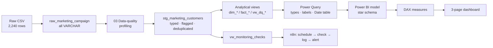
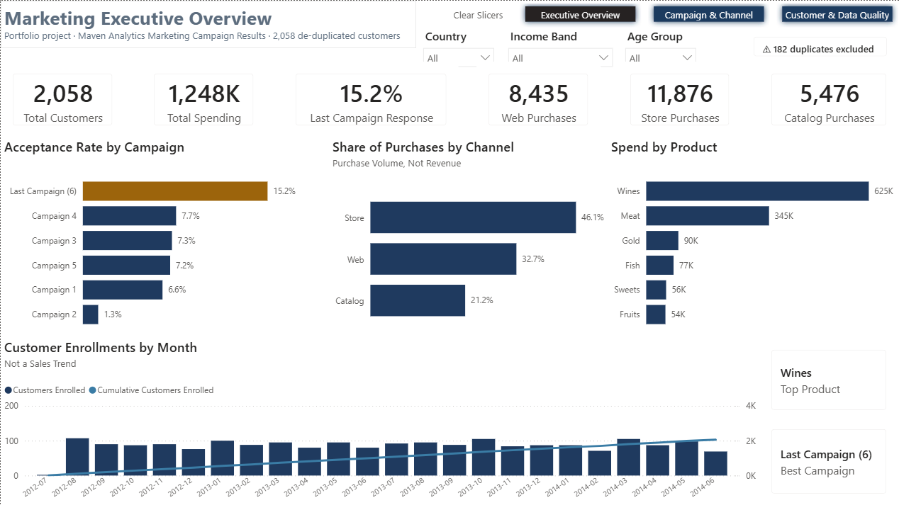
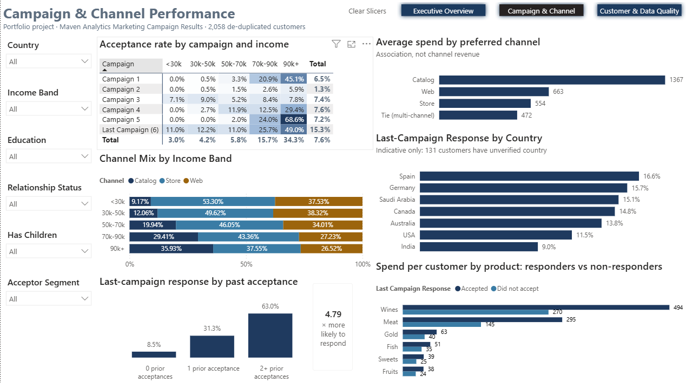
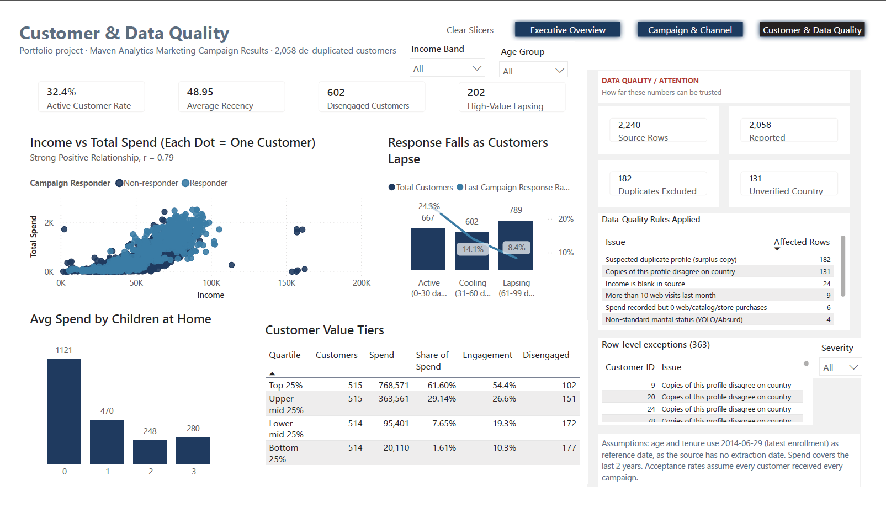

# Marketing Intelligence & Campaign Operations

End-to-end BI project: raw marketing data → MySQL cleaning & validation → star-schema Power BI model → DAX KPIs → 3-page dashboard → automated KPI / data-quality monitoring with n8n.

> **Portfolio project.** Built on the public Maven Analytics *Marketing Campaign Results* dataset. It is not data from, or work for, any employer, and it is not connected to a live production system. All results below are calculated from the dataset by the SQL in this repository.

  

---

## Overview
A marketing team has run six campaigns across ~2,240 customers and wants to know what worked, who responds, which channels and products drive value, and whether the numbers can be trusted. This project answers those questions with a reproducible SQL pipeline, a validated Power BI model and a scheduled monitoring workflow.

## Business Problem
Campaign results sit in a single wide export with no documentation of quality. Before this project:
- there was no single definition of acceptance rate, engagement or channel contribution;
- nobody had checked the file for duplicates or invalid values — and it contains **182 suspected duplicate rows that inflate totals by 8.8%**;
- there was no way to notice a data problem or a KPI drop without someone opening the file.

## Objectives
1. Profile, clean and validate the data in SQL with a full audit trail (nothing deleted).
2. Model it as a star schema that answers campaign, channel, product and customer questions with one measure each.
3. Define KPIs in DAX that reconcile exactly with SQL.
4. Build an executive-friendly dashboard with a visible data-quality section.
5. Automate KPI and data-quality monitoring with n8n.
6. Turn the analysis into evidence-based recommendations.

## Dataset
**Source:** [Maven Analytics — Marketing Campaign Results](https://mavenanalytics.io/data-playground/marketing-campaign-results)
2,240 rows × 28 columns: demographics, enrollment date, recency, spend on 6 product categories (last 2 years), purchases by channel, web visits, acceptance of 6 campaigns, complaints and country. See [`documentation/DATA_DICTIONARY.md`](documentation/DATA_DICTIONARY.md).

**What the data cannot support** (and is therefore not reported): sales trends over time (no transaction dates), revenue by channel (spend is per product), campaign ROI (no costs) and web conversion rates (visits and purchases cover different periods).

## Tools
SQL · MySQL 8 · Power BI · DAX · Power Query (M) · n8n · Git/GitHub

## Solution Architecture



| Step | Artefact |
|---|---|
| Create DB / load raw | [`sql/01_create_database.sql`](sql/01_create_database.sql), [`sql/02_create_raw_table.sql`](sql/02_create_raw_table.sql) |
| Data-quality profiling | [`sql/03_data_quality_checks.sql`](sql/03_data_quality_checks.sql) |
| Cleaning, de-duplication, star-schema views | [`sql/04_clean_marketing_data.sql`](sql/04_clean_marketing_data.sql) |
| Business-question analysis | [`sql/05_marketing_analysis.sql`](sql/05_marketing_analysis.sql) |
| KPI validation targets & monitoring objects | [`sql/06_kpi_queries.sql`](sql/06_kpi_queries.sql) |
| Power Query scripts, theme, build guide | [`powerbi/`](powerbi/) |
| n8n workflow | [`n8n/`](n8n/) |

## Data Model


Three fact tables at different grains (customer × campaign, × product, × channel) share one conformed Customer dimension. Filters are single-direction; the one cross-fact question (spend of campaign acceptors) is solved with `TREATAS` in DAX. The Date table covers enrollment only because the source has no purchase dates. Full rationale: [`powerbi/README.md`](powerbi/README.md#3-build-the-model).

## Data Quality
Every source row is kept in staging and flagged; reporting views use `include_in_reporting = 1`. Reconciliation: **2,240 raw = 2,058 reported + 182 excluded**.

| Issue | Rows | Handling |
|---|---|---|
| Suspected duplicate profiles (identical except ID/Country) | 182 | Lowest ID kept, others excluded |
| Country conflicts between duplicate copies | 131 | Kept, flagged "Unverified" |
| Missing income | 24 | NULL, band "Unknown" |
| Placeholder income 666,666 | 1 | Income → NULL, raw value kept |
| Birth years 1893/1899/1900 | 3 | Age → NULL, group "Unknown" |
| Non-standard marital status (YOLO/Absurd/Alone) | 7 | Standardised |
| Spend with 0 purchases / deals > purchases | 6 / 3 | Flagged |

Details, reasoning and impact: [`documentation/DATA_QUALITY.md`](documentation/DATA_QUALITY.md).

## Key KPIs
All values unfiltered, reconciled between SQL and DAX ([`documentation/DAX_MEASURES.md`](documentation/DAX_MEASURES.md)).

| KPI | Value | KPI | Value |
|---|---|---|---|
| Customers | 2,058 | Web purchases | 8,435 |
| Total spending | 1,247,643 | Catalog purchases | 5,476 |
| Average customer spend | 606.24 | Store purchases | 11,876 |
| Last campaign response rate | 15.21% | Deal purchases | 4,814 (18.7%) |
| Acceptance rate, all 6 campaigns | 7.54% | Active customers (≤ 30 days) | 32.41% |
| Campaign engagement rate (≥ 1 acceptance) | 27.65% | Average recency | 48.95 days |
| Prior-acceptor response lift | 4.79× | Complaint rate | 0.97% |

## Dashboard

| Page | Purpose |
|---|---|
| 1. Executive Marketing Overview | 6 KPI cards, campaign acceptance, channel share, product spend, customer enrollment trend |
| 2. Campaign & Channel Performance | Campaign × segment heatmap, prior-acceptor effect, channel mix by income, value by preferred channel, country view with caveats |
| 3. Customer & Data Quality | Engagement cards, income vs spend scatter, recency vs response, value tiers, **Data Quality / Attention panel** |





## Key Findings
1. **The last campaign performed best (15.21%) and Campaign 2 worst (1.26%)** — a twelve-fold gap across the same customer base.
2. **Past response predicts future response:** 8.5% (no prior acceptances) → 31.3% (one) → 63.0% (two or more).
3. **One segment drives over a third of responses:** customers with income ≥ 70k and no children are 16.1% of the base but produced 37.1% of last-campaign acceptances (35.1% response vs 11.4%). Among households with children, response stays around 9–12% at almost every income level.
4. **Spend is concentrated:** wines and meat are 77.8% of spend; the top 25% of customers generate 61.6%. Income and spend correlate strongly (r = 0.79).
5. **Recency matters for response, not for value:** active customers respond at 24.3% vs 8.4% for lapsing ones, but average spend is the same (~600). 202 top-quartile customers are lapsing.
6. **Store leads on volume (46.1%)**; catalog is smallest (21.2%) but catalog-preferring customers average 1,367 spend and 35.2% response. 26.1% of customers have never used the catalog, concentrated in income bands under 50k.
7. **Data quality:** without de-duplication, customer count and total spend would be overstated by 8.8%, while averages barely move — the kind of error that goes unnoticed.

## n8n Automation
**Marketing KPI Monitoring & Data Quality Alert** — Schedule (daily) → MySQL `vw_monitoring_checks` (9 checks) → log every result to `monitoring_log` → IF any ALERT → build one consolidated message → notification (placeholder node; swap in Gmail/Slack). Thresholds are stored in a table so they can change without editing the workflow. On the current data, 3 checks alert: suspected duplicates (182), invalid birth years (3) and weakest campaign below 2% (Campaign 2, 1.26%).
*This workflow demonstrates how BI monitoring could be automated. It is not connected to a live company production environment.* → [`n8n/README.md`](n8n/README.md)

## Business Recommendations
Summary — full Finding / Evidence / Implication / Action table in [`documentation/BUSINESS_RECOMMENDATIONS.md`](documentation/BUSINESS_RECOMMENDATIONS.md):
- Prioritise prior responders (431 customers, 56% of last-campaign acceptances) and test lower-cost contact for never-responders.
- Use *income ≥ 70k + no children* as a priority segment; test a different, deal-led offer for families, who use discounts 2.4× more.
- Review Campaign 2's design before re-using it, and add campaign cost/channel/date data so ROI can be measured.
- Run a re-engagement test for the 202 high-value lapsing customers.
- Keep catalog focused on 50k+ customers; evaluate expansion only once channel costs are available.
- Fix the duplicate-profile issue at source and keep automated monitoring in place.

## What I Learned
- **Uniqueness of an ID is not uniqueness of a customer.** The ID check passed; grouping on the full profile revealed 182 duplicates. Totals moved 8.8% while averages hardly changed, so the problem would have been invisible on rate-based dashboards.
- **Check segments together before recommending them.** Income looked like the driver of response until I split by children; the effect only exists in households without children.
- **Say what the data can't do.** Channel revenue, sales trends and ROI aren't available, and stating that clearly is more useful to a stakeholder than a chart that looks right but isn't.
- **Put each piece of logic in the right layer.** Fixed row rules in SQL, presentation in Power Query, filter-dependent maths in DAX — and reconcile SQL against DAX so every number has a second source.
- **Keep automation thin.** n8n only schedules, routes and notifies; the checks live in version-controlled SQL that the dashboard also uses.

## Future Improvements
Not implemented — possible next steps:
- Connect to a live marketing platform / CRM instead of a CSV extract
- Automate scheduled ingestion and incremental loading of new extracts
- Add campaign metadata (cost, channel, dates, offer type) to measure ROI
- Add web analytics data to measure the browse-to-purchase funnel
- Implement row-level security (e.g. by country or region)
- Use Power BI deployment pipelines (dev / test / prod)
- Connect production email/Slack notifications in n8n
- Confirm the duplicate rule with the data owner and enforce uniqueness at source

## Reproduce It
```bash
# from the repository root (MySQL 8, local_infile enabled: SET GLOBAL local_infile = 1;)
mysql -u <user> -p < sql/01_create_database.sql
mysql --local-infile=1 -u <user> -p marketing_intelligence < sql/02_create_raw_table.sql
mysql -u <user> -p marketing_intelligence < sql/03_data_quality_checks.sql
mysql -u <user> -p marketing_intelligence < sql/04_clean_marketing_data.sql
mysql -u <user> -p marketing_intelligence < sql/05_marketing_analysis.sql
mysql -u <user> -p marketing_intelligence < sql/06_kpi_queries.sql
```
Then follow [`powerbi/README.md`](powerbi/README.md) and [`n8n/README.md`](n8n/README.md). All SQL scripts were executed end-to-end on MySQL 8.0.

## Repository Structure
```
marketing-intelligence-campaign-operations/
├── README.md
├── data/
│   ├── README.md
│   ├── raw/                  source CSV + source dictionary
│   └── processed/            CSV exports of the analytical views (Power BI fallback)
├── sql/                      01–06 scripts (create, load, DQ checks, clean, analysis, KPIs/monitoring)
├── powerbi/
│   ├── README.md             model + Power Query + dashboard build guide
│   ├── data_model.png
│   ├── theme_marketing_intelligence.json
│   ├── power_query/          M script per query
│   └── dashboard_screenshots/
├── n8n/
│   ├── workflow.json
│   └── README.md
└── documentation/
    ├── DATA_DICTIONARY.md
    ├── DATA_QUALITY.md
    ├── DAX_MEASURES.md
    ├── BUSINESS_RECOMMENDATIONS.md
    └── INTERVIEW_PREPARATION.md
```

## Author
**Muhammad Saad** — [LinkedIn](https://www.linkedin.com/in/muhammad-saad-05ba76227) · [GitHub](https://github.com/Saadi8910)
