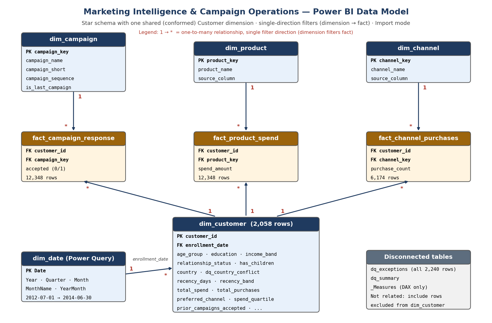

# Power BI — Model, Power Query and Dashboard Build Guide

This folder contains everything needed to build the report: Power Query scripts (`power_query/`), the theme (`theme_marketing_intelligence.json`), the model diagram (`data_model.png`) and, once built, the report file and screenshots.

Each step explains **what** to do and **why**, so the finished report can be defended in an interview.

---

## 0. Which layer does what?

| Layer | Used for | Examples in this project | Why this layer |
|---|---|---|---|
| **SQL (MySQL)** | Row-level cleaning, business rules, de-duplication, reshaping | Typing raw text, duplicate detection with window functions, income/age rules, banding, unpivoting campaigns/products/channels, DQ flags | Rules run **once**, are version-controlled, testable with a query, and are reused by both Power BI and n8n. Window-function de-duplication across 26 columns is natural in SQL and awkward in M. |
| **Power Query (M)** | Light shaping for the report | Explicit data types, friendly column names, Yes/No labels for 0/1 flags, "Country Status" label, generated Date table | Presentation concerns belong close to the report. Generating a calendar is standard Power Query work and needs no database object. |
| **DAX** | Anything that must react to slicers | Rates, shares, averages, best/worst campaign, cross-fact acceptor spend, DQ status text | A rate such as acceptance % must be re-computed for whatever segment the user selects. Pre-computing it in SQL would only be correct for one grouping. |

Rule of thumb used: *if the result depends on the user's filter selection → DAX; if it is a fixed property of a row → SQL; if it is only about how the data looks in the report → Power Query.*

---

## 1. Prerequisites
- Power BI Desktop (free, Windows).
- MySQL 8 with scripts `sql/01`–`06` executed.
- **MySQL ODBC driver** with a DSN pointing at the MySQL server (Windows → *ODBC Data Sources (64-bit)*). This build connects through ODBC.
- *Alternative:* the native MySQL connector also works, but requires **MySQL Connector/NET**; swap one line per query as shown in `power_query/00_parameters.pq`.
- No MySQL? Use the CSV fallback in `data/processed/` (also described in `00_parameters.pq`).

## 2. Load the data with Power Query
1. **Home → Transform data** to open Power Query Editor.
2. **Manage Parameters → New**: `OdbcDsn` = your DSN name, `DbName` = `marketing_intelligence` (both Text).
   *Why:* moving to another server or database later means changing one parameter, not ten queries.
3. For each file in `power_query/` (except `00_parameters.pq`): **New Source → Blank Query → Advanced Editor**, paste the code, and rename the query exactly as the file says: `Customer`, `Date`, `Campaign`, `Product`, `Channel`, `Campaign Response`, `Product Spend`, `Channel Purchases`, `DQ Exceptions`, `DQ Summary`.
   Create `Customer` **before** `Date`, because the calendar reads its min/max enrollment date.
4. Each query uses `Odbc.Query`, so Power BI asks once per query for **native query permission** — click **Run**. When asked for credentials, use **Default or Custom** if the DSN stores the login, otherwise **Database** with your MySQL user. *Why this is safe:* credentials are stored by Power BI on your machine, never inside the query text, so nothing secret ends up in Git.
5. **Close & Apply.** Check the row counts in Data view: Customer 2,058 · Campaign Response 12,348 · Product Spend 12,348 · Channel Purchases 6,174 · DQ Exceptions 363 · DQ Summary 9 · Date 730.

## 3. Build the model

### Relationships (Model view)

| From (many) | To (one) | Key | Cardinality | Filter direction |
|---|---|---|---|---|
| Campaign Response | Customer | Customer ID | * : 1 | Single (Customer → fact) |
| Product Spend | Customer | Customer ID | * : 1 | Single |
| Channel Purchases | Customer | Customer ID | * : 1 | Single |
| Campaign Response | Campaign | Campaign Key | * : 1 | Single |
| Product Spend | Product | Product Key | * : 1 | Single |
| Channel Purchases | Channel | Channel Key | * : 1 | Single |
| Customer | Date | Enrollment Date → Date | * : 1 | Single (Date → Customer) |

`DQ Exceptions` and `DQ Summary` stay **unrelated** (explained below).

### Why the model looks like this
- **The source is one wide row per customer.** A single flat table would work for cards, but "acceptance rate *by campaign*" would need six separate measures and could not be put on one axis. Unpivoting campaigns, products and channels (in SQL) gives three narrow facts that each answer one question with one measure — this is the main reason for a star schema here.
- **Three facts at different grains** (customer×campaign, customer×product, customer×channel) share one **conformed Customer dimension**, so a single slicer (e.g. Income Band) filters all of them consistently.
- **Single-direction filters only.** Bi-directional relationships between facts and Customer would create ambiguous filter paths between the three facts. The one cross-fact question ("spend of people who accepted campaign X") is solved in DAX with `TREATAS` instead (see `Spend of Campaign Acceptors`).
- **Customer-grain behaviour stays on Customer.** Recency, deal purchases, web visits and complaints have one value per customer. A separate 1:1 fact table would add a table and a relationship without adding any analytical capability, so they live on the dimension. This is a deliberate simplification.
- **Date → Customer, not Date → facts.** The only date is the enrollment date, a customer attribute. There are no transaction dates, so the Date table supports an **acquisition trend** only — the model makes that limitation explicit rather than hiding it.
- **DQ tables are disconnected** because `DQ Exceptions` includes the 182 excluded duplicates, which don't exist in Customer. Relating them would produce a "(Blank)" customer and mislead slicers.

### Model housekeeping (each takes seconds, each prevents a known problem)
1. **File → Options → Current file → Data load → turn off Auto date/time.** Otherwise Power BI creates a hidden date table per date column, bloating the model and conflicting with our Date table.
2. Select `Date` → **Table tools → Mark as date table** → `Date`.
3. **Sort by column:** `Campaign[Campaign]` by `Campaign Sequence`; `Customer[Income Band]` by `Income Band Order`; `Customer[Education]` by `Education Order`; `Customer[Recency Band]` by `Recency Band Order`; `Customer[Spend Quartile]` by `Spend Quartile Order`; `Date[Year Month]` by `Year Month Sort`. *Why:* without this, bands sort alphabetically (e.g. "<30k" after "90k+").
4. **Hide** all key columns on fact tables, the *Order/Sort* columns and `Source Column`. Report authors should only see fields meant for visuals.
5. Set **Summarize by: None** on `Customer ID`, `Birth Year`, `Age`, `Income`, `Recency Days` — summing IDs or birth years is a classic mistake.
6. Formats: `Income`, spend measures → whole number with thousands separator (currency is not stated in the source, so no symbol); rates → percentage, 1–2 decimals.

## 4. Add the measures
1. **Home → Enter data**, name the table `_Measures`, load it, then hide its column.
2. Create every measure from `documentation/DAX_MEASURES.md` on `_Measures`. Use **display folders** matching the document sections (Customer & Spend, Channel, Campaign, Product, Engagement, Data Quality).
3. Put a temporary card for each headline measure on a scratch page and compare to the **expected values** (section 7 below). Delete the scratch page once everything matches.

## 5. Apply the theme
**View → Themes → Browse for themes → `theme_marketing_intelligence.json`.** Navy for primary data, amber for highlights, red only for problems. *Why:* consistent colour meaning across pages; red is reserved for the attention panel so it is never confused with a data series.

## 6. Build the three pages
Canvas 1280 × 720 (16:9). Leave a 16-px margin, align visuals to a grid, use sentence-case titles that say what the visual shows ("Acceptance rate by campaign"), and turn off unnecessary gridlines and axis titles.

Every page has a thin header bar: page title, subtitle *"Portfolio project · Maven Analytics Marketing Campaign Results · 2,058 de-duplicated customers"*, and the `Data Quality Status` measure as a small text card at the right. Page navigation buttons go in the header.

### Page 1 — Executive Marketing Overview
*Goal: a marketing manager understands performance in 30 seconds.*

| Area | Visual | Fields | Why |
|---|---|---|---|
| Slicers (header, max 3) | Dropdown slicers | Country, Income Band, Age Group | Executives need few, high-level filters; detailed slicing is on page 2 |
| KPI row | 6 cards (new Card visual) | Total Customers · Total Spending · Last Campaign Response Rate (reference label: Campaign Acceptance Rate "all campaigns") · Web Purchases · Store Purchases · Catalog Purchases | The six numbers requested by the brief; the reference label avoids a 7th card |
| Middle left | Clustered bar | Axis Campaign; Value Campaign Acceptance Rate; data labels on; conditional colour: Last Campaign amber | Answers "which campaign worked best/worst" at a glance |
| Middle centre | Bar | Axis Channel; Value Channel Share %; tooltip Total Channel Purchases, Avg per channel | Channel contribution by **volume** (subtitle: "share of purchases — channel revenue not available in source") |
| Middle right | Bar, sorted desc | Axis Product; Value Total Spending; tooltip Product Spend Share %, Product Penetration % | Top-performing products |
| Bottom left (wide) | Column chart | Axis Date[Year Month]; Value Customers Enrolled; optional line Cumulative Customers Enrolled | The only valid time series. Title: **"Customer enrollments by month (not a sales trend)"** |
| Bottom right | 2 text cards | Best Campaign, Top Product | Plain-language answers that update with slicers |

*Customer spending trend:* not built, because the data has no purchase dates. Explaining this is better than charting enrollment-cohort spend and calling it a trend.

### Page 2 — Campaign & Channel Performance
*Goal: analysts and campaign managers explore who responds and through which channel.*

| Area | Visual | Fields | Why |
|---|---|---|---|
| Left slicer panel | Slicers | Country, Income Band, Education, Relationship Status, Has Children, Prior Acceptor Segment | Detailed segment exploration |
| Top left | Matrix heatmap | Rows Campaign; Columns Income Band; Values Campaign Acceptance Rate; background colour scale | Campaign × segment comparison in one view; the 70k+ bands light up |
| Top right | Column chart | Axis Prior Acceptor Segment; Value Last Campaign Response Rate; card beside it: Prior Acceptor Response Lift | Business question A5: 8.5% → 31.3% → 63.0%, lift 4.79× |
| Middle left | 100% stacked bar | Axis Income Band; Legend Channel; Value Total Channel Purchases | Which segments prefer which channel (catalog grows with income) |
| Middle right | Bar | Axis Preferred Channel; Value Average Customer Spend; tooltip Last Campaign Response Rate | Value of customers by preferred channel. Subtitle: "association, not channel revenue" |
| Bottom left | Clustered bar | Axis Product; Legend Last Campaign Response (from Customer); Value Average Customer Spend | Product mix of responders vs non-responders |
| Bottom right | Bar (not map) | Axis Country; Value Last Campaign Response Rate; tooltip Total Customers, Unverified Country Customers, Small Sample Warning | Geographic performance with its data-quality caveat. A bar is clearer than a map for 8 countries, and the tooltip warns about Mexico (n = 2) |

**Tooltip page (optional, good to show):** a small page (Page information → *Allow use as tooltip*, size *Tooltip*) with Campaign Acceptances, Avg Spend of Campaign Acceptors and Acceptance Rate vs Average (pp). Assign it to the campaign bar on pages 1 and 2.

### Page 3 — Customer & Data Quality
*Goal: understand customer value and engagement, and see how far the data can be trusted.*

Left two-thirds — customers:

| Visual | Fields | Why |
|---|---|---|
| 4 cards | Active Customer Rate %, Average Recency (days), Disengaged Customers, High-Value Lapsing Customers | Engagement health in four numbers |
| Scatter | X Customer[Income] (don't summarise); Y Customer[Total Spend] (don't summarise); Details Customer ID; Legend Campaign Responder | Income vs spend (r = 0.79) and where responders sit |
| Combo (column + line) | Axis Recency Band; Columns Total Customers; Line Last Campaign Response Rate | Recency vs response: 24.3% active → 8.4% lapsing |
| Column | Axis Children At Home; Value Average Customer Spend | Strongest household effect on spend |
| Table | Spend Quartile; Total Customers; Total Spending (add it twice, second copy → *Show value as: Percent of grand total*); Campaign Engagement Rate; Disengaged Customers | Value tiers and how engaged each is (top 25% = 61.6% of spend) |

Right third — **DATA QUALITY / ATTENTION** panel (light grey background, red header text):

| Visual | Fields | Why |
|---|---|---|
| 4 cards | Source Rows (2,240), Total Customers (2,058), Excluded Duplicate Rows (182), Unverified Country Customers (131) | Reconciliation the reader can check |
| Table | DQ Summary: Issue, Severity, Affected Rows, Pct Of Source Rows, Handling; icon conditional formatting on Severity | Every rule and its handling, visible in the report |
| Table + slicer | DQ Exceptions: Customer ID, Issue, Detail, In Reporting Set; slicer on Severity | Row-level follow-up list for the data owner |
| Text box | "Reference date 2014-06-29 used for age/tenure (no extraction date in source). Spend covers the last 2 years. Acceptance rates assume every customer received every campaign." | Assumptions stated where decisions are made |

Note: the DQ tables are disconnected, so customer slicers don't change them. That is intended — the panel describes the whole source file.

### Interaction settings
- **Format → Edit interactions:** on page 1, make the campaign bar *filter* (not highlight) the other visuals.
- Add a **Clear all slicers** button (Insert → Buttons → Clear all slicers) on pages 1–2.
- Keep slicer selections page-specific (don't sync slicers) so page 1 stays an unfiltered overview unless the user chooses otherwise.

## 7. Validate before you screenshot
With no filters applied the report must show exactly these values (from `sql/06_kpi_queries.sql`):

| Measure | Expected |
|---|---|
| Total Customers | 2,058 |
| Total Spending | 1,247,643 |
| Average Customer Spend | 606.24 |
| Campaign Acceptance Rate (all) | 7.54% |
| Last Campaign Response Rate | 15.21% |
| Campaign Engagement Rate | 27.65% |
| Web / Catalog / Store Purchases | 8,435 / 5,476 / 11,876 |
| Total Deal Purchases | 4,814 |
| Wines share of spend | 50.13% |
| Prior Acceptor Response Lift | 4.79 |
| Active Customer Rate % | 32.41% |
| Excluded Duplicate Rows | 182 |

Then test one filtered case: **Income Band = 90k+** → Total Customers 51, Last Campaign Response Rate 49.0%. If a number is off, see *Troubleshooting* in `documentation/INTERVIEW_PREPARATION.md` (Q14).

## 8. Save, screenshot, publish
1. Save as `powerbi/marketing_intelligence.pbix`. Optional but recommended for Git: also **File → Save as → Power BI Project (.pbip)**, which stores the model and report as text files so changes show up as readable diffs on GitHub. (The `.gitignore` already excludes the `.pbip` cache and local settings.)
2. Export one PNG per page into `powerbi/dashboard_screenshots/` named `01_executive_overview.png`, `02_campaign_channel.png`, `03_customer_data_quality.png` — the main README already links to these names.
3. Optional: publish to the Power BI Service. Use **Publish to web** only for this public dataset, never for company data.

## Performance notes
The model is small (≈ 33k fact rows), so performance is not a problem here, but the build follows habits that matter at scale: Import mode; narrow integer keys; only needed columns loaded; auto date/time off; no bi-directional relationships; no calculated columns where SQL can do the work; measures use `DIVIDE`, variables and `KEEPFILTERS` instead of `FILTER` over whole tables.
